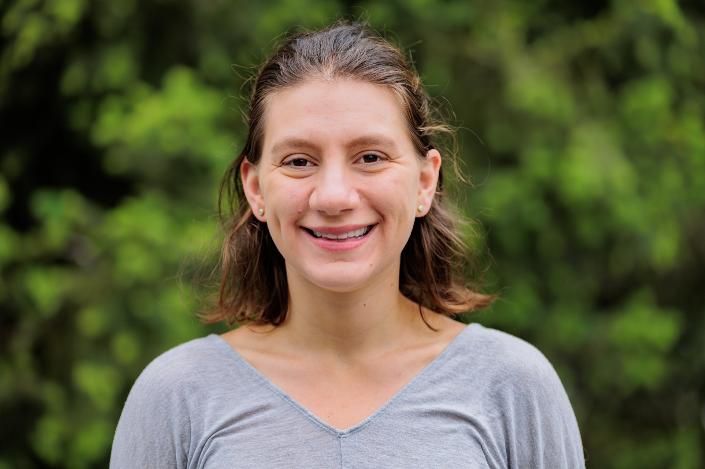

  

## About me

Hi, I'm Allie! I'm a first-year PhD student enrolled in the University of Washington MD/PhD program in Seattle, Washington. I work in the [Feder Lab](https://federlab.github.io/#) studying cancer evolution growth heterogeneity and clonal spatial reconstruction. 

My interests span various scientific fields, including evolutionary biology, cancer biology, virology, and data science. I am particularly fascinated by cancer evolution and tumor heterogeneity. My previous work has focused HIV evolution, SARS-CoV-2 genomic epidemiology, and mechanisms of how oncoviruses promote tumorogenesis. In my free time, I enjoy hiking with my dog, rock climbing, backpacking, and playing the cello and guitar.

## Get in touch

- Email: [allie.kreitman@gmail.com](mailto:allie.kreitman@gmail.com)
- LinkedIn: [alliekreitman](https://www.linkedin.com/in/alliekreitman/)
- ORCID: [0000-0002-0390-5425](https://orcid.org/0000-0002-0390-5425)

[CV](https://docs.google.com/document/d/1fOlEAimrEUoNOQ4pv-h6N55AFGvcoYNAP4u5GNnF61k/edit?usp=sharing) Read more nitty gritty details about what I have done.
